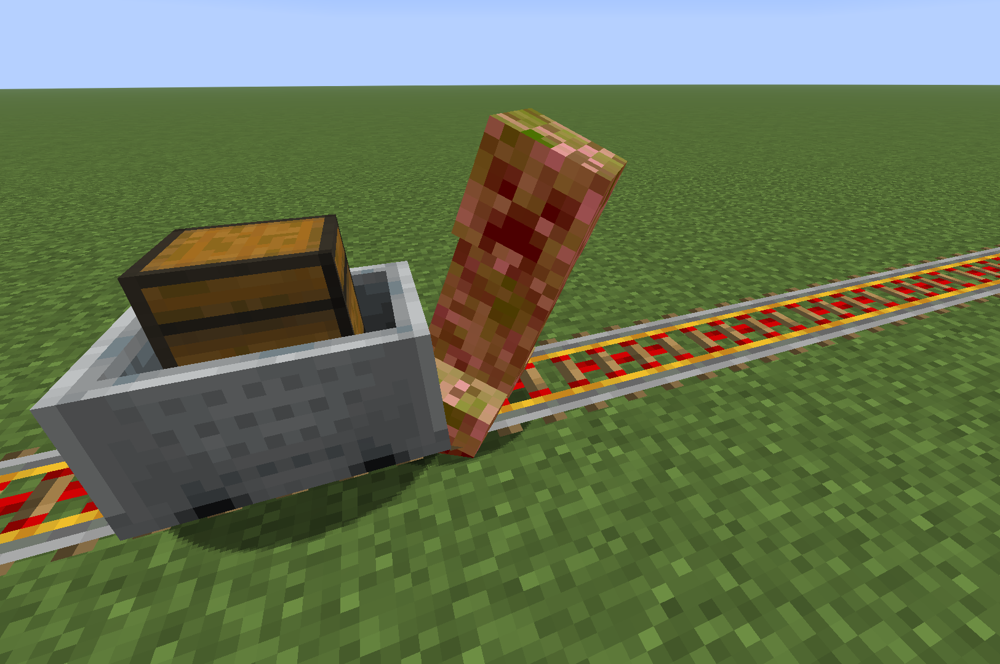
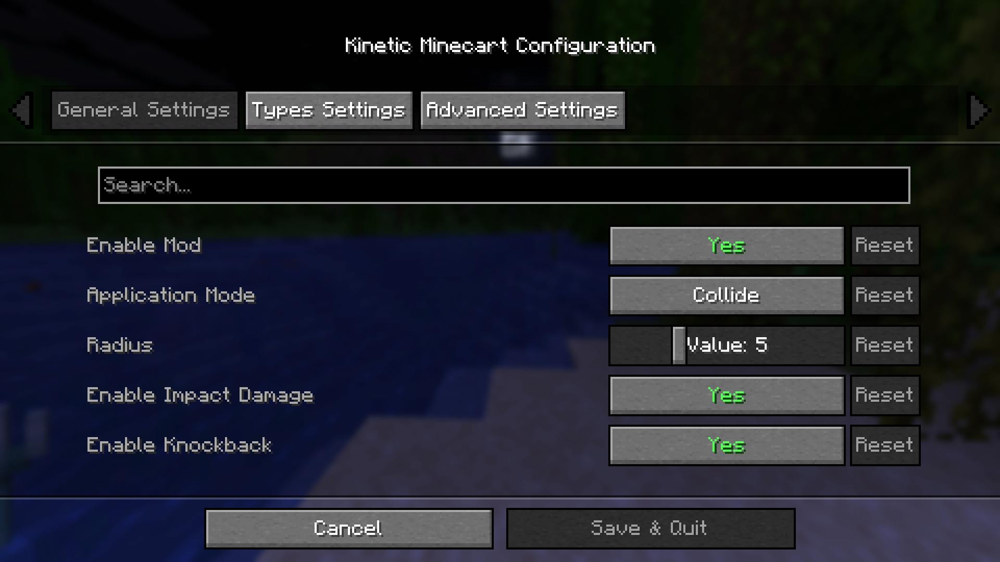
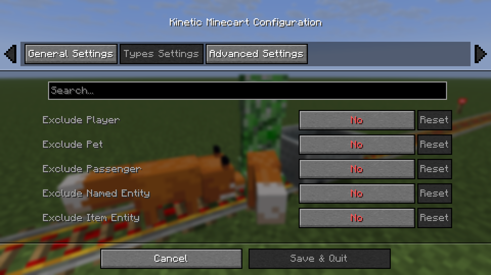
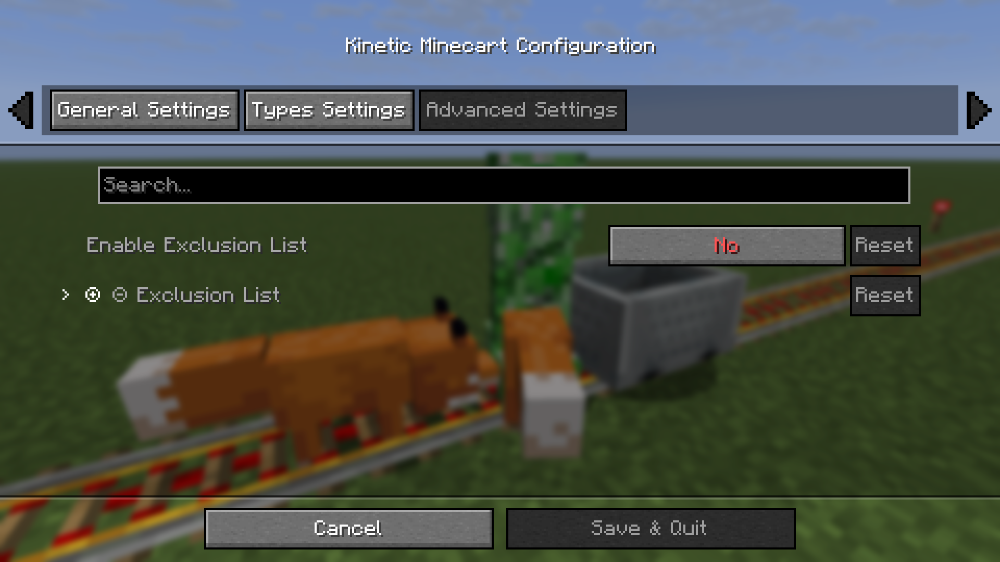
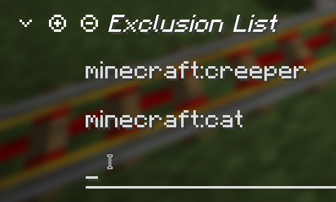

# Kinetic Minecart

Impact damage from high-speed minecarts!

This mod increases damage to moving minecarts; the faster they move, the higher the damage!

## Loaders

[](https://fabricmc.net)
[](https://neoforged.net)
[](https://files.minecraftforge.net/)

## Environments


## Releases

[](https://github.com/FuseLeaf/kinetic-minecart/releases)
[](https://modrinth.com/mod/kinetic-minecart)
[](https://www.curseforge.com/minecraft/mc-mods/kinetic-minecart)

## Compatibility

| Symbol    | Relation      |
| :-: | :-: |
| v         | Required      |
| o         | Optional      |
| x         | Incompatible  |

### Fabric

| Server Side       | Relation  | Description |
| :-- | :-: | :-- |
| Cloth Config API  | o         | Custom Configuration |

| Client Side       | Relation  | Description |
| :-- | :-: | :-- |
| Cloth Config API  | o         | Custom Configuration |
| Mod Menu          | o         | Client Configuration Entry |

### NeoForge / Forge

| Server Side       | Relation  | Description |
| :-- | :-: | :-- |
| Cloth Config API  | o         | Custom Configuration |

| Client Side       | Relation  | Description |
| :-- | :-: | :-- |
| Cloth Config API  | o         | Custom Configuration |

## Progress

Check out the latest development progress here: [Development Progress](https://fuseleaf.org/windysky/docs/minecraft-java-edition/kinetic-minecart/version)

## Gallery



## Features

- The damage dealt by minecarts is related to their **Speed**:

| Condition | Damage |
| --- | --- |
| Speed >= 6 | Damage = Speed cubed |
| Speed > 2 and < 6 | Damage = Speed squared |
| Target has Vehicle | Damage = Speed |
| Speed <= 2 | Damage = 0 |

- After being hit by a minecart, the entity is propelled approximately the same distance as its speed.

- It offers custom configuration options, including customizing the collision effects of the minecart.

## Configuration

Configuration files that will be generated after installing `Cloth Config API`:

- `.../config/kinetic-minecart.json`

### Singleplayer Mode







- You can edit the exclusion list, click on an item to name or delete it, and the inspection tool will attempt to proofread your input. (Sometimes, when you create a new item, the new text box may not appear; you may see an empty one, but this does not affect selection or input.)



### Multiplayer Mode

- In **Multiplayer Mode**, you **Cannot** change the configuration via the menu; instead, the server administrator needs to modify the 'kinetic-minecart.json' file. Below is an example:

<details>
  <summary>Example Configuration (Click to expand)</summary>

```
> kinetic-minecart.json

{
  "enable": true,
  "overrideCollision": true,
  "overrideRiding": true,
  "applicationMode": "COLLIDE",
  "radius": 5,
  "enableDamage": true,
  "damageMode": "TIERED",
  "enableKnockback": true,
  "excludePlayer": false,
  "excludePet": false,
  "excludePassenger": true,
  "excludeNamedEntity": false,
  "excludeItemEntity": false,
  "enableExclusionList": false,
  "exclusionList": []
}
```

</details>

<details>
  <summary>Configuration Details (Click to expand)</summary>

#### General

| Key | Value | Default Value | Note |
| --- | --- | --- | --- |
| enable | `true`/`false` | `true` | - |

##### Override

| Key | Value | Default Value | Note |
| --- | --- | --- | --- |
| overrideCollision | `true`/`false` | `true` | - |
| overrideRiding | `true`/`false` | `true` | - |

##### Application Mode

| Key | Value | Default Value | Note |
| --- | --- | --- | --- |
| applicationMode| `"COLLIDE"`/`"RADIUS"` | `"COLLIDE"` | - |
| radius | `<integer>` | `5` | Range: 3 to 10<br>Example: 5 -> 0.5 Blocks |

##### Damage

| Key | Value | Default Value | Note |
| --- | --- | --- | --- |
| enableDamage | `true`/`false` | `true` | - |
| damageMode | `"TIERED"`/`"KILL"` | `"TIERED"` | - |

##### Knockback

| Key | Value | Default Value | Note |
| --- | --- | --- | --- |
| enableKnockback | `true`/`false` | `true` | - |

##### Type

| Key | Value | Default Value | Note |
| --- | --- | --- | --- |
| excludePlayer | `true`/`false` | `false` | - |
| excludePet | `true`/`false` | `false` | Certain special entities cannot be excluded. |
| excludePassenger | `true`/`false` | `true` | - |
| excludeNamedEntity | `true`/`false` | `false` | - |
| excludeItemEntity | `true`/`false` | `false` | - |

#### Advanced

| Key | Value | Default Value | Note |
| --- | --- | --- | --- |
| enableExclusionList | `true`/`false` | `false` | - |
| exclusionList | `["<namespace>:<id>"]` | `[]` | Example 1: `["minecraft:creeper"]`<br>Example 2: `["minecraft:creeper", "minecraft:cat", "minecraft:fox"]` |

</details>

## License

GPL-3.0-or-later (GNU General Public License v3.0 or later)
